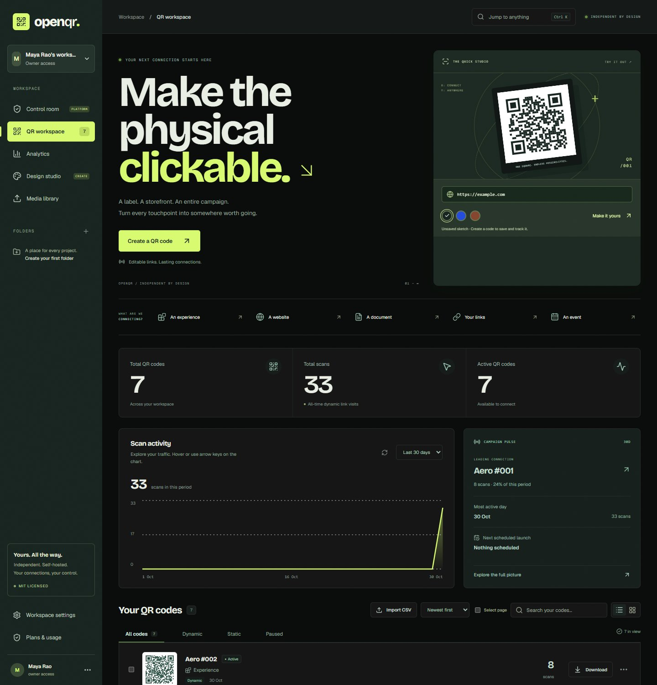
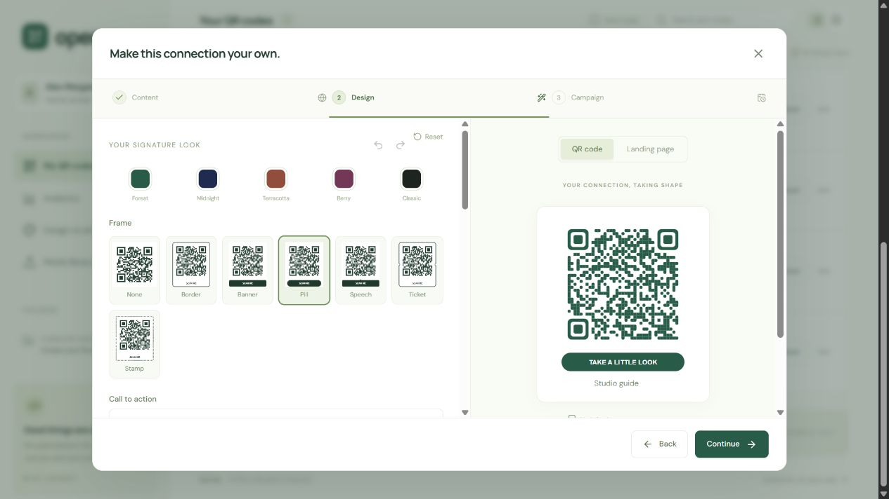
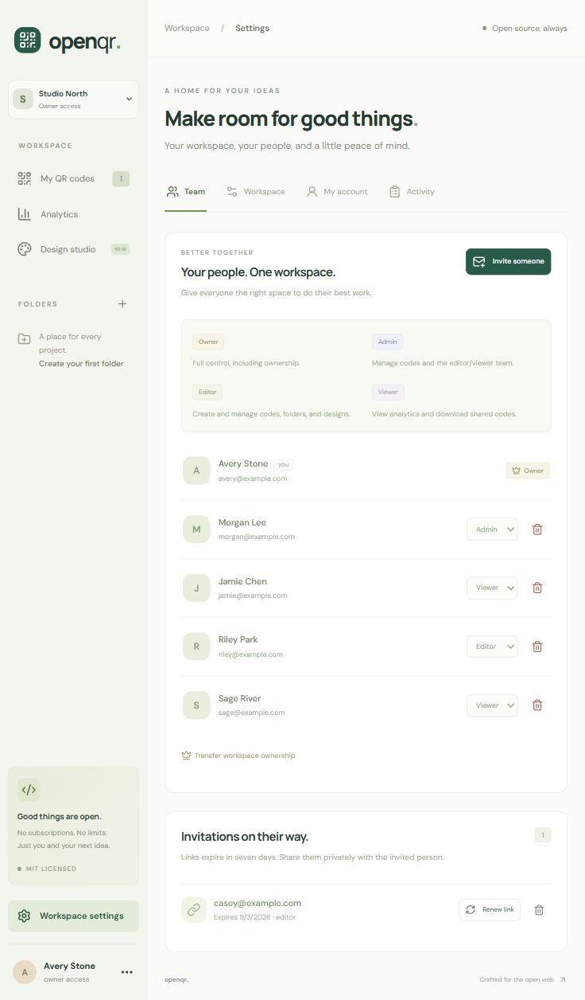
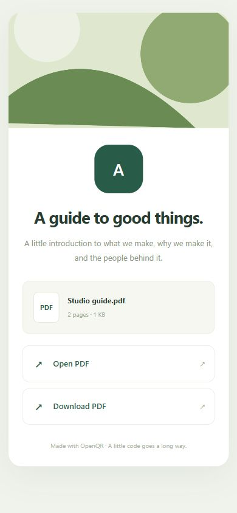

# OpenQR

**Your codes. Your connections. Your platform.**

A self-hosted, MIT-licensed QR workspace built with React, TypeScript, Express, and SQLite. Create real QR codes, keep printed website codes editable, and understand scan activity without a subscription.

This is an independent implementation. It does not reuse QR Code Generator's code, branding, or assets, and is not affiliated with Bitly.



_Dashboard from a disposable test workspace. Your instance starts empty._

## What's included in v0.5

### Connection studio interface

The workspace includes a live QR sketchpad with URL and ink-color handoff to the
full editor, quick starts for common QR types, and a command menu that searches
workspace codes, pages, and actions. Press **Ctrl/Cmd K** or **/** to search, and
**N** to create a code when you are not typing in a field. Inside the command menu,
use arrow keys and Enter, or Escape to close it.

Scan charts support pointer exploration and keyboard navigation: focus the chart
and use Left/Right or Home/End to inspect individual UTC dates. Sort the code
collection by creation date, scans, or name, and switch between list and grid views.
The interface adapts to phones and tablets and respects reduced-motion preferences.
The dashboard's Campaign pulse highlights the leading code, most active UTC day,
and next scheduled launch using the workspace's actual scan and campaign data.

### Platform features

- Account setup, invite-based team signup, password updates, operator-managed recovery, session management, and profile settings.
- Workspaces with Owner, Admin, Editor, and Viewer roles enforced by the server across codes, exports, folders, designs, analytics, and team administration.
- Single-use invitations, expiry, renewal, revocation, password-confirmed ownership transfer, and a workspace security activity log.
- Twenty QR types: website, plain text, Wi-Fi, email, phone, vCard, SMS, WhatsApp, location, calendar event, link page, PDF, digital contact, business page, social media, image gallery, audio, video, hosted event page, and app stores.
- Dynamic website codes: change destinations without changing the printed QR; pause and resume links.
- Static codes: content lives directly in the QR and does not depend on the server.
- A three-step editor with visual galleries: seven module styles, four finder styles, independent inner/outer and per-corner styles/colors, seven frame choices, top/bottom captions, logo sizing, built-in symbols, and undo/redo/reset. Preview and downloads share one renderer.
- Save and reuse your own brand designs, including for bulk imports.
- Download PNGs at 512, 1024, or 2048 px, and vector SVGs. Select up to 100 codes for ZIP downloads with a manifest or CSV information export.
- CSV import for website, text, and vCard codes. Up to 100 rows per batch, preview before saving, and atomic validation: a failed row leaves the whole batch unchanged.
- Hosted, editable mobile link pages with up to 12 links and an about section.
- Campaign tools: permanent custom short links, activation and expiry times, optional owner-selected scan caps, and website UTM tags.
- Folders, search, filters, list/grid views, pagination, duplicate codes, and batch move/pause/resume/delete.
- Real redirect analytics: daily scans, approximate daily unique visitors, devices, browsers, operating systems, referrer hosts, top codes, and CSV exports for 7/30/90-day ranges.
- Workspace media library for PDFs, portraits, cover images, and reusable logos. PDF.js reader with page navigation, zoom, text extraction, and downloads.
- Themed digital contact cards with vCard downloads, business pages with hours/directions, and social pages with platform links.
- Image galleries with reordering and captions, audio/video players with seeking, hosted event pages with calendar downloads, and device-aware app-store routing with a web fallback. Reusable page templates share layout and styling across these pages.
- Per-workspace storage quotas, bounded uploads, optional private S3-compatible media storage, and off-server backup copies.
- Database + media snapshot backups, automatic retention, checksum validation, and offline restore with preservation of previous data.
- SQLite persistence, self-hosted fonts/PDF resources, responsive layouts, Docker configuration, and GitHub Actions checks.

There is no third-party analytics SDK or external font service. No sample scans or prefilled campaigns are added to your workspace.



## Upgrading from v0.1, v0.2, or v0.3

Back up your DATA_DIR, stop the server, install dependencies with `npm ci`, rebuild with `npm run build`, and restart. The schema migrates automatically on startup. Existing code IDs, short links, saved content, and scan history are preserved. Older scans show `Unknown` for newly introduced analytics fields. Changing a design only changes future downloads; copies already printed retain their original design and payload.

v0.3 assigns each existing account and its codes, folders, designs, and sessions to an owner workspace. Existing password hashes remain compatible. No printed links change. The migration runs transactionally and checks database references before committing; schema versions from a newer release are rejected rather than downgraded.

v0.4 adds workspace media metadata and page themes. Files live in DATA_DIR/media; keep the entire data directory on a persistent volume. Existing QR payloads, URLs, sessions, and scan history remain unchanged. Back up the previous release before starting a newer server: old binaries cannot open a newer schema.

## Teams and workspaces

### Company operator console

Company staff access is separate from customer workspace Owner/Admin/Editor/Viewer
roles. It is disabled by default: signup and workspace invitations never grant it.
The server administrator can bootstrap a company Super Admin on an existing account:

```sh
npm run operator -- grant --email owner@example.com
npm run operator -- grant --email support@example.com --role support
npm run operator -- revoke --email owner@example.com
npm run operator -- list
```

Use the running installation's `DATA_DIR`. Refresh the app after a grant to see
**Control room** at `/control-room` (restricted to company staff). The console
includes installation totals, hourly dynamic-link visits, recent workspace and
operator activity, searchable paginated workspace and
account directories, storage/backup status, manual backups, and password-confirmed
account session revocation. Data refreshes every five seconds and can be paused.
It does not measure current online users, physical free disk space, or arbitrary
HTTP requests. Session counts are unexpired sign-ins. Operator grants and audit
records are stored in the database and travel with backups.

#### Customer support and privacy

Open any workspace from **Control room → Workspaces → Open account** to see its
plan, usage, members, and recent cases. Staff can open support cases (billing,
subscription, account, technical) with internal notes, status, priority, and
assignment; fix plan access through Billing; and suspend or restore a customer
account (password-confirmed, with a recorded reason; sessions end and sign-in is
blocked, while content and printed links are untouched). Company staff accounts
cannot be suspended here.

Customers can contact support from **Settings → Support**; they see only their own requests and replies staff mark as visible (internal notes stay hidden), and a customer reply reopens a resolved request.

Neither side needs email: customers see a badge on **Workspace settings** and a "New reply" marker on the request, and staff see a count on **Control room** and the **Cases** tab for open cases where the customer spoke last. Counts refresh every 30 seconds.

Optional outbound alerts (set `SMTP_URL`, `SMTP_FROM`, `SUPPORT_ALERT_EMAIL`, and/or `SUPPORT_WEBHOOK_URL`, see `.env.example`): staff are emailed or sent a webhook message (Slack-compatible) when a request arrives or a customer replies, and customers are emailed when staff post a customer-visible reply. Messages say only that something needs attention and link to the app; request text is never sent. Delivery failures are logged and never block a request.

Privacy boundaries: staff see masked email addresses by default and must give a
reason to reveal one. QR content, visitor records, uploaded media, and passwords
are never exposed through the control room. Customer views, reveals, case
changes, and account actions are written to a **Staff audit** log that only a
Super Admin can read.

Company departments have separate server-enforced permissions:

| Staff role | Internal access |
| --- | --- |
| Super Admin | All console functions, staff assignment, and hosted-plan management |
| Operations | Aggregate metrics, workspaces, activity, runtime, and backups |
| Support | Customer/workspace directories, activity, and password-confirmed session revocation |
| Billing | Aggregate metrics, workspace directory, and hosted-plan management |
| Analyst | Aggregate analytics only; no customer directories or management actions |

Super Admins can assign or remove staff in **Control room → Company staff**, with
password confirmation. The UI prevents removal of the last Super Admin. The server
CLI remains a trusted bootstrap/recovery boundary and can explicitly revoke grants.
Revocation and department changes apply to existing sessions on the next request.

Workspace roles share the studio interface with permission-aware controls. Viewers
can read and download; Editors can manage content; Admins can also manage Editors
and Viewers; Owners can manage Admins and transfer ownership. None of these roles
implicitly grants platform access. QR creation, updates, duplication, pause/resume,
move, deletion, and CSV imports now write workspace Activity events atomically.
Earlier QR actions are not retroactively reconstructed.

### Social QR destinations

A Social media QR opens a hosted page listing your channels. That QR needs a
reachable OpenQR server. A `localhost` address cannot reach your computer from a
phone; the editor and download dialog show a warning for loopback destinations.
Use a permanent HTTPS `PUBLIC_URL` for printed dynamic codes. For a single profile
without a server dependency, use **Use a direct profile QR instead** in a new
social editor, or create a static Website code. Static destinations cannot be
edited after printing and do not produce scan analytics.

Social buttons use shared SVG icons in the editor and published page. Named social
platforms require HTTPS and a matching platform domain; duplicate social destinations
are rejected. Pages support up to 12 labeled links. These constraints run on both
the client and server.

Use the workspace menu to create or switch workspaces. Codes, folders, saved designs, and analytics belong to a workspace; removing a member preserves their contributions and printed links.

| Role   | Codes and designs    | Analytics and exports | Team administration                              |
| ------ | -------------------- | --------------------- | ------------------------------------------------ |
| Owner  | Create, edit, delete | View and download     | All roles; password-confirmed ownership transfer |
| Admin  | Create, edit, delete | View and download     | Invite and manage Editors/Viewers                |
| Editor | Create, edit, delete | View and download     | View members                                     |
| Viewer | Read only            | View and download     | View members                                     |

In **Workspace settings → Team**, create an invitation for an email and a role. The link is shown once for private sharing. No email is sent automatically. Links expire after seven days and work once. Renewing a link invalidates its previous token. Existing account holders must sign in with the invited email; a link cannot silently attach another logged-in account.

Demoting/removing a manager revokes their pending invitations when they lose team-management rights. Only an Owner may appoint or manage Admins. The owner cannot be removed or demoted through ordinary member controls. Team changes apply to existing sessions on their next API request.

Owners and Admins can view the latest 100 team/account security events in **Activity**. Passwords and live invitation/recovery tokens are excluded. **My account** lets each user update their name/password, inspect sessions, sign out another session, or sign out all other sessions. Password changes rotate the current session and revoke the others.



_Team preview from a disposable test workspace; names and example.com addresses are test data._

### Account recovery

The server operator can issue a recovery link without an email-provider dependency:

```sh
npm run recover -- --email owner@example.com
# Docker:
docker compose exec openqr npm run recover -- --email owner@example.com
```

Use the same DATA_DIR and PUBLIC_URL as the running instance. Share the printed link privately with the account owner, who chooses their new password. Recovery links expire after 30 minutes, are stored only as hashes, work once, and replace earlier recovery links. A successful reset signs out every session and requires a new sign-in. Invitation and recovery secrets use URL fragments and are removed from the browser address bar after loading. An operator-issued link grants password-reset access: server/database access is a trusted administrative boundary.

New and changed passwords use versioned scrypt with N=32768, r=8, p=3 and a random salt. Legacy hashes continue to verify until a password change or recovery. Email-address changes, self-service email recovery, two-factor authentication, and SSO are not implemented in v0.4.

## Designer and hosted pages

The designer uses high error correction, a four-module quiet zone, and protected positioning/timing patterns. Module styles are square, gapped, rounded, dots, vertical, horizontal, and connected. Outer and inner finders can be square, rounded, soft-circle, or leaf, with global or per-corner colors. Frames include outline, banner, pill, speech, ticket, and stamp. Choose caption position/size, add a logo or built-in symbol, and use undo/redo/reset before saving a reusable design.

Colors must remain dark on a light background with at least 4.5:1 contrast, including customized finders. The preview, PNG, SVG, and ZIP exports share one vector renderer. Automated tests decode representative combinations, mixed corner styles, logos, symbols, and caption positions; test your final design at its intended print size on your target phones.

The Docker image includes DejaVu fonts for PNG frame captions. Native Linux hosts also need an installed font family (for example, DejaVu Sans) for server-rendered captions.

### Media and publishing

Upload PDF, PNG, or JPEG files up to **20 MB** in **Media library** or from the editor. The server checks actual content, rejects invalid/encrypted PDFs and active image formats, and re-encodes images with a 16-million-pixel input limit. Images are reduced to at most 1600 pixels; reusable logos become PNGs at most 128 pixels. Saved QR logos embed their sanitized bytes, so removing a library logo does not change a saved code. The direct design API still accepts embedded PNG/JPEG logos up to 128 KB and 4 million pixels.

- **PDF:** title, description, cover, document metadata, reader, and download. Replace the selected file while retaining the permanent QR link. Direct mode skips the landing page and opens the reader.
- **Digital contact:** portrait, organization/title, phone, email, website, address, and a downloadable vCard with escaped/folded text.
- **Business:** cover, contact actions, map directions, weekly opening hours, and up to 12 extra links. Hours use the business's displayed local clock time; split/overnight hours are not supported yet.
- **Social media:** up to 12 labeled links with platform icons, cover, and description.
- New publishing pages include Minimal, Soft, and Bold themes, an accent color, optional attribution, and a landing-page preview. Existing link pages retain their original layout.

The PDF reader uses locally bundled [Mozilla PDF.js](https://mozilla.github.io/pdf.js/) resources (Apache-2.0). It renders pages with bounded canvases, provides accessible extracted text, and does not enable embedded document scripts, interactive forms, or annotations. Scanned documents need the original download for OCR or other editing tools. There is no external viewer or CDN dependency.

Files are workspace-private in the library. Attaching them to a published page intentionally makes them available to anyone who opens its active short link. Public file requests require a short-lived, code-bound ticket and current publication status. Pausing/expiring the code prevents future file requests; already downloaded copies remain with their recipients. A ticket lasts 15 minutes; reopening the QR page renews it. Reader/file requests do not add scans. A final allowed scan can still load its document after reaching the campaign cap.

The server prevents deletion of files still referenced by a code. Replace/remove the file on every referencing page, then delete it from the library. Deleting a code leaves its library files available for reuse. Media lives on the server's persistent disk by default. Set `S3_BUCKET` (plus `S3_ENDPOINT`, `S3_REGION`, `S3_FORCE_PATH_STYLE` as needed) to store it privately in S3-compatible storage, and `S3_BACKUP_BUCKET` to copy backups off the server. Stop OpenQR and run `npm run storage:sync -- --confirm-stopped` to move existing local files (add `--prune-local` to remove verified local copies). `WORKSPACE_STORAGE_MB` (default 1024) and `MAX_UPLOAD_MB` (default 100, max 500) bound usage. Malware scanning is future work.



## Backups and restore

In **Workspace settings → Workspace → Storage and backups**, all members can see
their workspace's media usage, quota, upload limit, and storage type, with warnings
at 80% and at the quota limit. Owners and Admins also see installation-wide backup
status: schedule, local retention, last attempt/completion/failure, and local versus
off-server results. The panel refreshes every 30 seconds and has a manual refresh.

Manual and scheduled backups record results in `DATA_DIR/backups/backup-status.json`.
A failed off-server copy is reported separately from a completed local archive.
Raw error messages, paths, and bucket names are not exposed; the operator can inspect
server logs for details. Older backups created before status recording are not
retroactively marked successful. An interrupted attempt remains marked as started
with no recorded completion. These timestamps do not verify archive availability,
free disk space, or recovery readiness; continue checking backups and rehearsing restore.

A running server creates its first database + media snapshot after 24 hours of uptime, then every 24 hours. Configure BACKUP_INTERVAL_HOURS (0 disables scheduling; maximum 576 hours) and BACKUP_RETENTION (default 7 archives). Manual backups work while the server runs:

```sh
npm run backup
# Docker:
docker compose exec openqr npm run backup
```

Use the same DATA_DIR and PUBLIC_URL as the server. Archives go to DATA_DIR/backups and include an online SQLite snapshot, every library file, and a checksum manifest. Media mutations coordinate with backup creation through a filesystem lock. Scheduling resumes from startup after a restart; use an external scheduler for calendar-based backups or frequently restarted instances.

**Restore requires a stopped server.** With the same release installed and DATA_DIR configured:

```sh
npm run restore -- --archive /absolute/path/openqr-backup.tar.gz --confirm-stopped
npm start
```

For Docker, stop the service, then use a one-off container with the existing data volume and the archive accessible in that volume:

```sh
docker compose stop openqr
docker compose run --rm --no-deps openqr npm run restore -- --archive /app/data/backups/ARCHIVE.tar.gz --confirm-stopped
docker compose up -d
```

Restore validates paths, entry types, checksums, SQLite integrity, schema compatibility, and media references before replacing data. Current database/media are preserved in DATA_DIR/restore-history. Archives are bounded to 10,000 entries and 1 GiB uncompressed by default; set RESTORE_MAX_BYTES explicitly for a larger trusted archive. Restore supports this release's schema, not automatic schema downgrades. Preserve the original PUBLIC_URL and DNS so printed links remain reachable.

Backups contain account hashes, sessions, QR data, and published/private files. They are not encrypted by the app. Restrict access, copy archives off the server, and practice restoration; a same-disk backup does not protect against disk/server loss. Neither archive retention nor restore cleans older restore-history directories automatically.

## Campaigns and CSV workflows

Campaign dates are entered in the browser's local time zone and stored in UTC. Scan caps count successful GET visits over the code's lifetime, including clicks and bots. A code that is paused, outside its date window, or at its cap does not record further successful scans. These caps are optional campaign controls; OpenQR does not impose a subscription scan quota. Short-link slugs are permanent after creation.

For CSV imports, download the sample for your content type in **Import CSV**. Required headers are `name,url`, `name,text`, or `name,fullname`. vCard rows may include `company,phone,email`; all rows may include an optional unique `slug`. Standard comma/semicolon CSV, quoted fields, and multiline text are parsed by Papa Parse. Every row must validate before any code is saved. Batch sizes are bounded for predictable memory use on small self-hosted servers.

Select codes to download a ZIP of PNGs or SVGs, export code information as CSV, move them into a folder, or pause/resume dynamic codes. Static codes cannot be paused. A duplicate gets a new tracking link and a fresh scan history.

## Run locally

Requires **Node.js 24+** and npm. Node's built-in SQLite API may print an experimental warning on Node 24.

```sh
git clone https://github.com/rahulvyasm/openqr.git
cd openqr
npm ci
cp .env.example .env
npm run dev
```

On Windows PowerShell, use `Copy-Item .env.example .env` instead of `cp` if preferred. Open **http://localhost:5173** and create the owner account. The API runs on port 3001; Vite proxies API and redirect requests to it. Use `localhost`, matching `PUBLIC_URL`, rather than `127.0.0.1` when opening the app.

The first account claims the instance and owns its initial workspace. Further signup requires an invitation; public registration is disabled. Claim your instance on a trusted local connection before exposing it publicly.

## Production

```sh
npm ci
npm run build
```

Set `.env` for your deployment, then run `npm start`:

```dotenv
NODE_ENV=production
PORT=3001
PUBLIC_URL=https://qr.your-domain.com
COOKIE_SECURE=true
DATA_DIR=./data
# Only if exactly one trusted reverse proxy fronts this process:
TRUST_PROXY=1
```

Terminate HTTPS at a reverse proxy pointing to port 3001. Do not expose the origin port publicly when trusting a proxy. Requests changing data must include an Origin matching PUBLIC_URL. For local production testing, use PUBLIC_URL=http://localhost:3001 and COOKIE_SECURE=false.

Startup validates settings before creating the data directory or opening the database.
With `NODE_ENV=production`, `PUBLIC_URL` is required and must use HTTPS with
`COOKIE_SECURE=true`; HTTP is allowed only for `localhost`, `127.0.0.1`, or `::1`
for local testing. Use an origin without credentials, a path, query, or fragment.
`COOKIE_SECURE` accepts only `true`/`false`, and `TRUST_PROXY` only `1`/`0`.
Invalid ports, empty bind addresses/data directories, invalid backup settings, and
invalid storage limits stop startup with a configuration error. Development retains
its localhost defaults. Production binds to `0.0.0.0` unless `HOST` is set.

Deployment probes can use `/health/live` and `/health/ready`; readiness checks the
database and configured media storage. The automated startup test boots and restarts
a production-mode local server and checks both endpoints.

**Choose a permanent, publicly reachable PUBLIC_URL before printing dynamic QR codes.** A phone cannot reach your computer through its own `localhost`. If the public origin changes, previously printed codes still point at the old origin. Keep the old domain resolving and forwarding traffic. Dynamic redirects require your server to stay online.

### Docker

```sh
docker compose up --build -d
```

By default, Docker serves http://localhost:3001 and stores data in the `openqr-data` volume. Set PUBLIC_URL, COOKIE_SECURE, and TRUST_PROXY in your shell or `.env` for HTTPS hosting. The runtime uses a non-root user. The Docker image build and a running-container smoke test are verified for this release.

## Development and checks

```sh
npm test
npm run build
```

Run the isolated recovery drill with `npm run test:recovery`. It creates a temporary
disk-backed workspace, invites a Viewer, publishes website/PDF codes, records scans,
and runs the backup and restore operator commands. The recovered app must preserve
code IDs and short links, the snapshot's destinations and scan counts, downloadable
PDF bytes, owner access, and Viewer permissions. It also checks that restore history
preserves the replaced installation and that new scans still work after recovery.
The drill runs as part of `npm test` and CI, uses local storage, and ignores local
environment files and S3 settings. It does not touch your configured data directory.

This checks the release's recovery workflow with disposable data. For your deployment,
also rehearse restoring an actual backup onto a separate, stopped installation using
the same release. Keep that installation private, check media and team access, and
verify the recorded `PUBLIC_URL` before switching traffic. An isolated drill cannot
verify your public domain, reverse proxy, remote credentials, or backup availability.

Tests exercise authentication, CSRF protection, ownership isolation, redirect tracking, destination edits, campaign limits, safe hosted pages, static content immutability, folders, atomic bulk operations, ZIP contents, template persistence, and migration from the original database schema. Download tests decode generated PNGs to check the actual encoded QR content, including every module/finder/frame combination and a logo-bearing code.

```
src/                React interface and browser helpers
src/components/     Editor, designer, bulk workflows, analytics and dialogs
shared/             Shared SVG renderer and calendar payload encoding
server/app.js       Express app, auth, base SQLite schema and folders
server/auth.js      Accounts, sessions, invitations and recovery flows
server/workspaces.js Workspace migration, membership, roles and activity
server/security.js Shared password, authorization and transaction helpers
server/manage.js   Operator-only recovery command
server/codes.js     Migrations, codes, campaigns, templates and analytics
server/design.js    Logo sanitization, SVG/PNG rendering
server/pages.js     Safe public mobile pages
server/storage.js   Workspace uploads, media validation and publishing migration
server/publishing.js Page schemas and content validation
server/backup.js    Snapshot archives, checksums, retention and offline restore
scripts/pdf-assets.js Local PDF reader resource preparation
server/payload.js   QR content validation and encoding
server/index.js     Environment and process lifecycle
test/               API and QR decoding tests
```

## Analytics and privacy

Only visits to dynamic `/r/:slug` tracking links are measured. Static codes are not tracked. HTTP GET visits count as scans, including clicks and bots; this is not a camera-scan detector. HEAD requests do not count. UTC dates define daily buckets.

Approximate unique visitors are salted hashes of IP address, user agent, and UTC date; raw IPs and user agents are not saved in the scan table. The same visitor on different days counts again. Counts are estimates and may be affected by shared IPs, bots, or changing devices. Browser and OS categories are inferred from the user agent. Referrer hosts are stored without paths or query strings; scanner apps typically report no referrer. The SQLite database retains scan records until the code is deleted. There is no geolocation or tracking cookie on redirect requests.

Auth cookies are HttpOnly and SameSite=Strict, and Secure when COOKIE_SECURE=true. API writes require same-origin requests; auth and API endpoints are rate-limited. Stored QR content, including Wi-Fi passwords, is readable by the workspace owner and anyone with database access. Protect the database and backups accordingly.

## Backups

Back up your complete DATA_DIR and preserve your public domain. Stop the server before making a filesystem copy of the SQLite directory, or use a SQLite-aware online backup tool. Copying only the main database while it is being written can omit data in the WAL. Never commit the database or `.env` to Git.

## Scope and roadmap

### Hosted tiers and INR pricing

The self-hosted edition includes all features without hosted QR/team plan caps.
To operate a managed service, set `HOSTED_MODE=true`. Each workspace then receives
a hosted tier with the same feature set and different resource limits:

| Tier | QR codes | Media storage | Team seats |
| --- | ---: | ---: | ---: |
| Free | 25 | 100 MB | 3 |
| Creator | 1,000 | 5 GB | 10 |
| Business | 10,000 | 50 GB | 50 |

These initial tier limits live in `shared/plans.js`. Set display prices in whole
INR per workspace/month using `PLAN_CREATOR_MONTHLY_INR` and
`PLAN_BUSINESS_MONTHLY_INR`. Prices are unannounced until configured. For Docker,
also pass those optional price variables to the container in `compose.yaml`.
`HOSTED_MAX_OWNED_WORKSPACES` defaults to 3 per account, independently of tier limits.
Pending invitations reserve team seats; acceptance rechecks capacity after a downgrade.

**Online payment collection is not implemented or active.** No checkout link,
subscription charge, or paid-invoice status is fabricated. Company Billing staff
and Super Admins can provision manual access with password confirmation under
**Control room → Billing**. Payment-provider integration, recurring-charge handling,
verified webhooks, and final INR amounts are still required before selling hosted
subscriptions. Manual access is labeled as operator-provisioned, not paid.

**Plans & usage** shows the current workspace plan, actual usage, and the hosted
catalog. Limits are enforced server-side across ordinary creation, duplication,
atomic bulk imports, uploads, and invitations. A downgrade blocks new additions
above the new limit; it never deletes saved content or pauses existing printed links.
Hosted storage limits replace the self-hosted `WORKSPACE_STORAGE_MB` quota;
per-file upload limits still apply to every plan. Staff privileges and workspace
plans are independent: a paid plan never grants company control-room access.

v0.3 supports multiple workspaces and invited teams on a single self-hosted SQLite instance. The [competitive roadmap](docs/ROADMAP.md) covers custom domains, file/media pages, API keys, routing rules, automated backups, PostgreSQL-backed hosted operations, and further hardening. Billing and subscription limits are outside this self-hosted edition. A private GitHub repository stays private; the MIT license does not automatically publish its contents.

## Open source

Licensed under [MIT](LICENSE). Source: [rahulvyasm/openqr](https://github.com/rahulvyasm/openqr). See [CONTRIBUTING.md](CONTRIBUTING.md) and [SECURITY.md](SECURITY.md).
