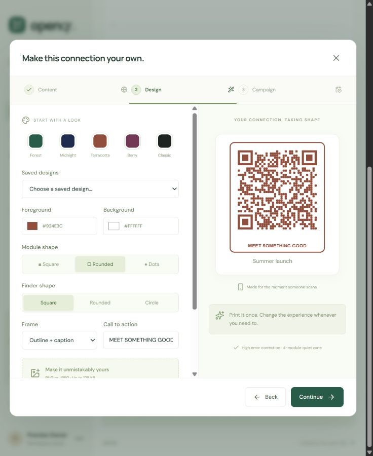

# OpenQR

**Your codes. Your connections. Your platform.**

A self-hosted, MIT-licensed QR workspace built with React, TypeScript, Express, and SQLite. Create real QR codes, keep printed website codes editable, and understand scan activity without a subscription.

This is an independent implementation. It does not reuse QR Code Generator's code, branding, or assets, and is not affiliated with Bitly.


_Dashboard from a disposable test workspace. Your instance starts empty._

## What's included in v0.2

- Owner account setup and sign-in, password hashing, expiring server-side sessions, and sign-out.
- Eleven QR types: website, plain text, Wi-Fi, email, phone, vCard, SMS, WhatsApp, location, calendar event, and hosted link pages.
- Dynamic website codes: change destinations without changing the printed QR; pause and resume links.
- Static codes: content lives directly in the QR and does not depend on the server.
- A three-step editor with a shared live preview and export renderer: three module styles, three finder styles, foreground/background colors, logo uploads, caption frames, and five starting designs.
- Save and reuse your own brand designs, including for bulk imports.
- Download PNGs at 512, 1024, or 2048 px, and vector SVGs. Select up to 100 codes for ZIP downloads with a manifest or CSV information export.
- CSV import for website, text, and vCard codes. Up to 100 rows per batch, preview before saving, and atomic validation: a failed row leaves the whole batch unchanged.
- Hosted, editable mobile link pages with up to 12 links and an about section.
- Campaign tools: permanent custom short links, activation and expiry times, optional owner-selected scan caps, and website UTM tags.
- Folders, search, filters, list/grid views, pagination, duplicate codes, and batch move/pause/resume/delete.
- Real redirect analytics: daily scans, approximate daily unique visitors, devices, browsers, operating systems, referrer hosts, top codes, and CSV exports for 7/30/90-day ranges.
- SQLite persistence, self-hosted fonts, responsive layouts, Docker configuration, and GitHub Actions checks.

There is no third-party analytics SDK or external font service. No sample scans or prefilled campaigns are added to your workspace.



## Upgrading from v0.1

Back up your DATA_DIR, stop the server, install dependencies with `npm ci`, rebuild with `npm run build`, and restart. The schema migrates automatically on startup. Existing code IDs, short links, saved content, and scan history are preserved. Older scans show `Unknown` for newly introduced analytics fields. Changing a design only changes future downloads; copies already printed retain their original design and payload.

## Designer and hosted pages

The designer uses high error correction and preserves QR positioning and timing patterns. Logo uploads accept PNG/JPEG files up to 128 KB and 4 million pixels; the server validates and re-encodes them to a small PNG before storage. SVG uploads, remote logo URLs, and inverted/low-contrast designs are rejected. The code preview and exports share one SVG renderer.

The test suite decodes all 27 combinations of the three module styles, three finder styles, and three frame styles. This is an automated check with representative content, not a guarantee for every printer or camera: test your final design at its intended print size.

The Docker image includes DejaVu fonts for PNG frame captions. Native Linux hosts also need an installed font family (for example, DejaVu Sans) for server-rendered captions.

Choose **Link page** in the editor to build a mobile page hosted behind its permanent `/r/` link. The page is publicly accessible to anyone with the link while active, and visits count in analytics. Content is escaped and links must use HTTP(S). Deleting or pausing the code also makes its hosted page unavailable.

## Campaigns and CSV workflows

Campaign dates are entered in the browser's local time zone and stored in UTC. Scan caps count successful GET visits over the code's lifetime, including clicks and bots. A code that is paused, outside its date window, or at its cap does not record further successful scans. These caps are optional campaign controls; OpenQR does not impose a subscription scan quota. Short-link slugs are permanent after creation.

For CSV imports, download the sample for your content type in **Import CSV**. Required headers are `name,url`, `name,text`, or `name,fullname`. vCard rows may include `company,phone,email`; all rows may include an optional unique `slug`. Standard comma/semicolon CSV, quoted fields, and multiline text are parsed by Papa Parse. Every row must validate before any code is saved. Batch sizes are bounded for predictable memory use on small self-hosted servers.

Select codes to download a ZIP of PNGs or SVGs, export code information as CSV, move them into a folder, or pause/resume dynamic codes. Static codes cannot be paused. A duplicate gets a new tracking link and a fresh scan history.

## Run locally

Requires **Node.js 24+** and npm. Node's built-in SQLite API may print an experimental warning on Node 24.

```sh
git clone https://github.com/rahulvyasm/openqr.git
cd openqr
npm ci
cp .env.example .env
npm run dev
```

On Windows PowerShell, use `Copy-Item .env.example .env` instead of `cp` if preferred. Open **http://localhost:5173** and create the owner account. The API runs on port 3001; Vite proxies API and redirect requests to it. Use `localhost`, matching `PUBLIC_URL`, rather than `127.0.0.1` when opening the app.

The first account claims the instance. Public registration is disabled. Claim your instance on a trusted local connection before exposing it publicly.

## Production

```sh
npm ci
npm run build
```

Set `.env` for your deployment, then run `npm start`:

```dotenv
PORT=3001
PUBLIC_URL=https://qr.your-domain.com
COOKIE_SECURE=true
DATA_DIR=./data
# Only if exactly one trusted reverse proxy fronts this process:
TRUST_PROXY=1
```

Terminate HTTPS at a reverse proxy pointing to port 3001. Do not expose the origin port publicly when trusting a proxy. Requests changing data must include an Origin matching PUBLIC_URL. For local production testing, use PUBLIC_URL=http://localhost:3001 and COOKIE_SECURE=false.

**Choose a permanent, publicly reachable PUBLIC_URL before printing dynamic QR codes.** A phone cannot reach your computer through its own `localhost`. If the public origin changes, previously printed codes still point at the old origin. Keep the old domain resolving and forwarding traffic. Dynamic redirects require your server to stay online.

### Docker

```sh
docker compose up --build -d
```

By default, Docker serves http://localhost:3001 and stores data in the `openqr-data` volume. Set PUBLIC_URL, COOKIE_SECURE, and TRUST_PROXY in your shell or `.env` for HTTPS hosting. The runtime uses a non-root user. The Docker image build and a running-container smoke test are verified for this release.

## Development and checks

```sh
npm test
npm run build
```

Tests exercise authentication, CSRF protection, ownership isolation, redirect tracking, destination edits, campaign limits, safe hosted pages, static content immutability, folders, atomic bulk operations, ZIP contents, template persistence, and migration from the original database schema. Download tests decode generated PNGs to check the actual encoded QR content, including every module/finder/frame combination and a logo-bearing code.

```
src/                React interface and browser helpers
src/components/     Editor, designer, bulk workflows, analytics and dialogs
shared/             Shared SVG renderer and calendar payload encoding
server/app.js       Express app, auth, base SQLite schema and folders
server/codes.js     Migrations, codes, campaigns, templates and analytics
server/design.js    Logo sanitization, SVG/PNG rendering
server/pages.js     Safe public mobile pages
server/payload.js   QR content validation and encoding
server/index.js     Environment and process lifecycle
test/               API and QR decoding tests
```

## Analytics and privacy

Only visits to dynamic `/r/:slug` tracking links are measured. Static codes are not tracked. HTTP GET visits count as scans, including clicks and bots; this is not a camera-scan detector. HEAD requests do not count. UTC dates define daily buckets.

Approximate unique visitors are salted hashes of IP address, user agent, and UTC date; raw IPs and user agents are not saved in the scan table. The same visitor on different days counts again. Counts are estimates and may be affected by shared IPs, bots, or changing devices. Browser and OS categories are inferred from the user agent. Referrer hosts are stored without paths or query strings; scanner apps typically report no referrer. The SQLite database retains scan records until the code is deleted. There is no geolocation or tracking cookie on redirect requests.

Auth cookies are HttpOnly and SameSite=Strict, and Secure when COOKIE_SECURE=true. API writes require same-origin requests; auth and API endpoints are rate-limited. Stored QR content, including Wi-Fi passwords, is readable by the workspace owner and anyone with database access. Protect the database and backups accordingly.

## Backups

Back up your complete DATA_DIR and preserve your public domain. Stop the server before making a filesystem copy of the SQLite directory, or use a SQLite-aware online backup tool. Copying only the main database while it is being written can omit data in the WAL. Never commit the database or `.env` to Git.

## Scope and roadmap

v0.2 is a working single-owner workspace, not complete feature parity with a commercial SaaS. The [competitive roadmap](docs/ROADMAP.md) covers team roles, account recovery, custom domains, file/media pages, API keys, routing rules, audit logs, and production hosting. Billing and subscription limits are outside this self-hosted edition. A private GitHub repository stays private; the MIT license does not automatically publish its contents.

## Open source

Licensed under [MIT](LICENSE). Source: [rahulvyasm/openqr](https://github.com/rahulvyasm/openqr). See [CONTRIBUTING.md](CONTRIBUTING.md) and [SECURITY.md](SECURITY.md).
